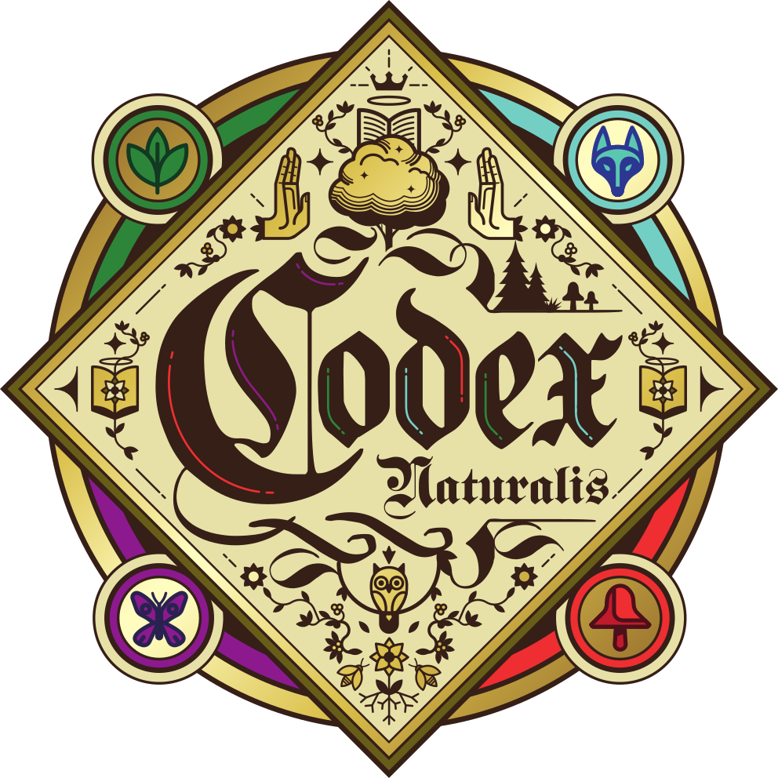

<h1 align="center">
    </a>
     
    Codex Naturalis
     
</h1>

A digital adaptation of the card game **Codex Naturalis**, playable right in your browser.

## The game

Each player builds their own manuscript by placing cards corner to corner. Cards provide resources (plant, animal, fungi, insect) and objects (quill, inkwell, manuscript). Place them cleverly to unlock more powerful cards, score points and complete shared or secret objectives.

The first player to reach 20 points triggers the end of the game. The player with the most points, objectives included, wins.

## The project

The goal is to start a game from a simple website, with nothing to install:

- first with 2, 3 or 4 players on the same screen;
- then online, each player from their own home.

## Credits

@pmael

Codex Naturalis is a game by Thomas Dupont, illustrated by Maxime Morin. All rights to the original game belong to its authors and publisher.